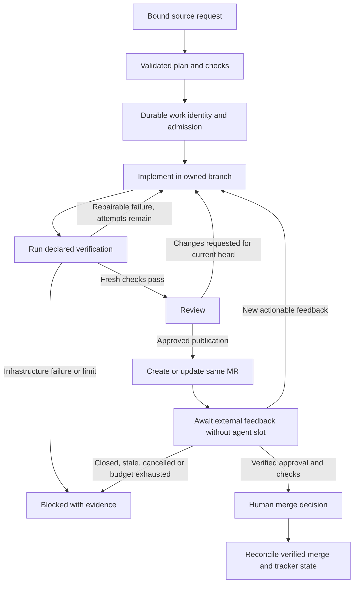

# Workflow reliability audit

Baseline: `58a35b24`, 2026-10-10. Scope is workflow correctness across service, contract, client, cockpit and desktop supervision. RBAC redesign is excluded. This is an architecture and lifecycle audit, not a claim that every line or live vendor API has been certified.

## Verdict

Cezar is a capable local agent cockpit with good isolation, delivery receipts and observability. It is not yet a reliable unattended software factory. Main gap is not missing tools: workflow intent, session completion, fresh verification, publication and review feedback are separate mechanisms without one durable work-item lifecycle.

Keep TypeScript, Hono, React, existing runner/provider seams and JSON/NDJSON. A rewrite or new database would not repair lifecycle semantics. Refactor one load-bearing boundary at a time and prove old scenarios under shipped defaults.

## Workflow map and audit coverage

| Stage | Current guarantees | Main gap / next action |
| --- | --- | --- |
| Intake | CLI/manual/tracker/schedule/GitHub sources share ordinary run launch. Tracker source binding and event receipts tested. | GitLab review events absent. Linear status/label history not verified. Scheduled GitHub repository identity can remain stale after remote change. |
| Planning | Planner discovers skills/checks, validates model JSON, falls back to quick-task. YAML rejects duplicate IDs and backward-invalid retry targets. | Malformed planned steps can be dropped while remaining plan is reported non-fallback. No requirement that discovered checks actually appear. |
| Admission | Shared workspace semaphore, per-project caps, account hold and queue watchdog. Worktree or explicit in-place lease. | Explicit live/user continuations bypass normal queue by design. Cross-process run ownership is weaker than automation delivery leases. |
| Execution | Eight backends use one runner interface, normalized events and per-session ownership tokens. | RunManager and server each exceed 5,000 lines. Shared behavior still distributed across lifecycle branches. Check commands lacked owned process-tree lifecycle. |
| Verification | Check exit codes, bounded onFail loops, captured output and step rail. | Before this refactor checks had no wall-clock bound, output cap could overshoot, spawn/signal failures could buy repair attempts. No commit-bound verification artifact. |
| Continue/revision | Same branch/session, portable context on backend switch, source credentials revalidated. | Before this refactor Continue could finish without rerunning declared checks/review stages. Synthetic session ID was not durable workflow-stage identity. |
| Recovery | Queued definitions/attachments survive restart. Running sessions recover via Continue. Usage limits re-arm. | Restart/check-only replay can repeat side effects; queued continuation text replaced by generic recovery prompt. Retry budget resets across recoveries. |
| Dispatch | Branch-forked children, count and budget caps, durable reports, child-to-parent wake. | Review-child verdict is prompt discipline, not an enforced acceptance gate. Reports do not prove fresh checks on the merged result. |
| Publication | GitLab draft create/reuse, explicit push and review gate controls, separate merge action. First fix batch corrected preflight-before-autosave. | Published MR metadata and source issue linkage remain provider-fragmented. Runtime done is not publication/review completion. |
| Feedback loop | Manual Send back/Continue. GitHub event intake can create new tasks. | No durable issue/branch/MR identity coordinating feedback on current head; duplicate delivery receipts are not per-MR revision serialization. |
| UI/event recovery | One workspace SSE stream, query-cache patching and authoritative reconciliation on reconnect/visibility. | Preview count-only; logs omit available source identities. Status can hide pending external review/sync. |
| Storage/retention | Atomic index replacement, append events, unknown foreign records retained, old task branches kept when worktrees reclaimed. | No same-run cross-process write ownership, whole-array initial parsing, dirty-work retention needs stronger evidence. |
| Boot/shutdown | Shared context creation, graceful missing-dependency defaults, managed desktop supervision. | Boot recovery occurs before dispatch CLI URL is populated. CLI shutdown flushes and exits rather than draining child processes. |
| Packaging | Contract parity/typed client, production tarball gate and installed CLI tests. | Green fixture tests do not certify live vendor history completeness or desktop/process topology. |

## Confirmed workflow defects addressed in this refactor

### 1. Continue/restart skipped required workflow tail

Before change, `workflows/run.ts` `runContinuation` awaited session result and called `settleSuccess` directly. `recover` routed a running task through that path. A workflow such as implement, review, verify could resume implementation and report done while review/verify stayed pending. A later code revision could also retain old successful verification without re-execution.

Fix: one `runWorkflowSteps` loop now runs initial workflows and resumed tails, including existing onFail retry behavior, step transitions, final autosave and settlement. Optional `StepState.workflowStepId` preserves original stage independently of provider session affinity. Backend switches keep stage rather than silently jumping to last agent step. Latest executed session is chosen by start time rather than append order, because re-executed original steps are not appended.

Non-final resumed sessions close after normal turn-end with existing drain delay, retaining ASK/monitoring/dispatch pauses. After successful resumed stage, subsequent checks/review stages are reset and executed. Failed check remains failed, not done. Legacy no-definition sessions keep ordinary Continue behavior. Explicit Finish on an unanswered park remains an explicit stop, not an automatic workflow continuation.

Regression evidence: pre-fix tests reproduced missing review prompt, missing check artifact after restart, and failed check becoming done. New tests cover repeated revisions, backend switch stage tools, bounded onFail loop and latest stage selection.

### 2. Check processes had no owned bounded lifecycle

Before change, `runCheckStep` used `spawn('bash', ['-lc', command])`, no deadline, signalled only shell and appended an entire chunk before enforcing cap. Cancel dropped check-only run from active registry before process teardown. Child could keep writing after another task gained slot or in-place lease. Error plus close could emit duplicate final check output.

Fix: small `workflows/check.ts` owns command, capped UTF-8 output, one result, fixed 30-minute deadline and TERM/KILL escalation. POSIX checks run in dedicated process group; timeout/cancel kills group, including children with inherited pipes or background children remaining when shell closes. Check PID participates in existing telemetry/memory guard. Cancelled status remains immediate but slot/lease release waits for result cleanup. Windows has direct-child fallback, not a claim of equivalent process-group supervision.

No new dependency, daemon or environment flag. Same shell and cwd retained; intentionally not changing users' shell initialization in this slice. Fixed check deadline matches existing noninteractive agent default. Per-step timeout customization is deferred until needed.

### 3. Infrastructure failure incorrectly consumed code-repair attempts

`retryableExit(undefined, -1)` returned true although -1 means spawn failure or signal termination. A dead process is not evidence code is wrong. Now zero/nonpositive exits never trigger automatic repair; ordinary positive command exit handling and explicit retryOn lists unchanged. Timeout/error output remains on failed step and run for diagnosis.

## Important unresolved findings

These are not hidden by successful refactor tests:

1. **No trustworthy complete external review loop yet.** Need verified provider/host/repository/immutable issue/MR/head association, event-to-existing-work-item routing, one writer per MR, feedback dedup per head, finite rounds and explicit stop reasons. Native Linear-GitLab integration can own issue state where public reachability permits it. Never install competing status writers by default.
2. **Verification is not tied to source-tree identity.** A done check says when command ran, not which commit/dirty snapshot it certified. Store observed head/tree identity and invalidate on later edits before publication or merge decisions. Re-running declared tail fixes common continuation path, not every external/manual write.
3. **Continuation prompt/attachments for queued recovery are not fully durable.** `PendingContinuation` is process memory and `reviveQueuedRun` uses generic restart prompt. Persist intent before queuing if exact replay matters; never replay vendor writes without an action receipt.
4. **Retry budget across crash/recovery.** Current per-tail map bounds one execution stretch, not total automatic recovery attempts. Persist cycle/attempt identity before retries. A human new revision may deliberately reset budget, an automatic restart must not.
5. **Boot order:** `index.ts` calls recovery before assigning CEZ_API_URL/CEZ_BIN and listening. Recovered child/automation-facing sessions can start without reachable cockpit commands. Stage admission until server is listening rather than merely moving URL assignment earlier.
6. **Shutdown/disposal:** CLI signal handler flushes then exits; project `dispose` explicitly does not end live sessions. Add bounded drain that stops admission, settles/persists ownership and reaps processes without claiming completed work. Manager cancellation is not service-wide drain.
7. **Persistence races:** `RunStore.saveNow` unions foreign IDs but explicitly lacks lock across read/rename. Same-run concurrent writers can overwrite fields. Keep one owner per run or introduce lease/revision checks before expanding multi-process scheduling. Atomic rename alone is not transaction isolation.
8. **Initial index salvage:** `RunStore.open` parses entire array; one malformed entry can make all records unavailable. Per-entry salvage with clear omitted-record diagnostics is preferable, preserving raw evidence and avoiding silent data loss on later writes.
9. **Planner truthfulness:** `sanitizeSteps` drops malformed steps and unknown skills; surviving steps can be returned with fallback false. Report dropped stages and don't silently remove proposed verification. Prefer repository check discovery and a transparent plan diff over model-proposed generic checks.
10. **Retention and autosave:** terminal run status alone does not prove dirty/untracked files safely committed. Preserve failed autosave reason and refuse destructive reclaim while work lacks durable branch evidence. Do not turn storage cleanup into a success mechanism.
11. **Large orchestration files:** `server/server.ts` ~6,838 lines and `workflows/run.ts` ~5,853 at baseline contain multiple responsibilities. Extract execution, stage resume and admission mechanisms with tests before route/controller cosmetics. Do not genericize provider differences into invented parity.

## Target workflow

Keep local runtime status separate from work-item delivery status. Every nonterminal state must have a concrete wake source or explicit blocked owner. Polling a vendor indefinitely inside an agent session is not a workflow engine.

## Delivery sequence

1. This slice: owned checks, shared resumed-tail execution, stage lineage, truthful infrastructure failure. Validate old quick-task/ASK/monitoring defaults and mixed backends.
2. Durable workflow cursor, retry cycle and queued continuation intent. Safe boot/listening barrier and bounded service drain.
3. Provider-scoped work-item identity, verified publication discovery and source-rich preview/log UI. Fix stale forge identity and host transport before wider event support.
4. One opt-in GitLab feedback-to-revision cycle using existing scheduler/receipt engine. Start with read-only discussions/pipeline/current-head operations, not automated merge.
5. Completion reconciliation through one status owner, failure injection across lost responses/restarts and live read-only vendor certification.

RBAC, OAuth onboarding, multi-tenant isolation and visual redesign are not this workstream. Existing trust boundaries and destructive-action guards stay intact.

## Validation

Validated on Linux, Node 26.10.0, installed Vitest 4.1.10:

- `npm run typecheck`: passed across contract, client, service and cockpit.
- Complete Vitest scope, run as sequential workspace projects to fit command-runtime limits: server 4,663 passed, cockpit/client 4,507 passed. Total **9,170 passed**, three existing opt-in Copilot smoke tests skipped.
- `npm run test:unit`: **42 passed**.
- `npm run build`: passed, including tarball inventory check (780 files).
- `npm run test:package`: **17 passed**, including installed tarball CLI execution.
- Five lifecycle regressions failed against original implementation before fixes. Additional tests cover bounded retries, repeated stage lineage, backend switches, resumed turn-end, output bounds, timeout and SIGTERM-resistant descendant cleanup.

One existing Copilot cancellation test exposed a polling race against its 20ms mock turn during the first full run. Test now interrupts at tool-start event; production runner was unchanged, full server rerun passed. Test environment clears enclosing task routing variables, preserves installed Node for login-shell checks and disables Node's native Web Storage for jsdom. No production configuration changed.

No browser/manual desktop certification or live authenticated vendor operations, publication, merge or production automation setup. Passing tests establish this refactor's execution guarantees, not completion of the remaining factory roadmap.
